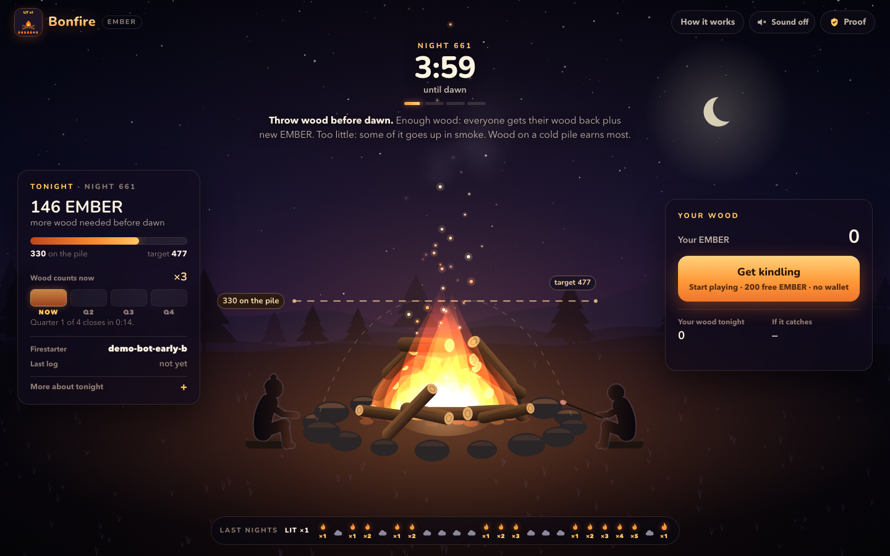
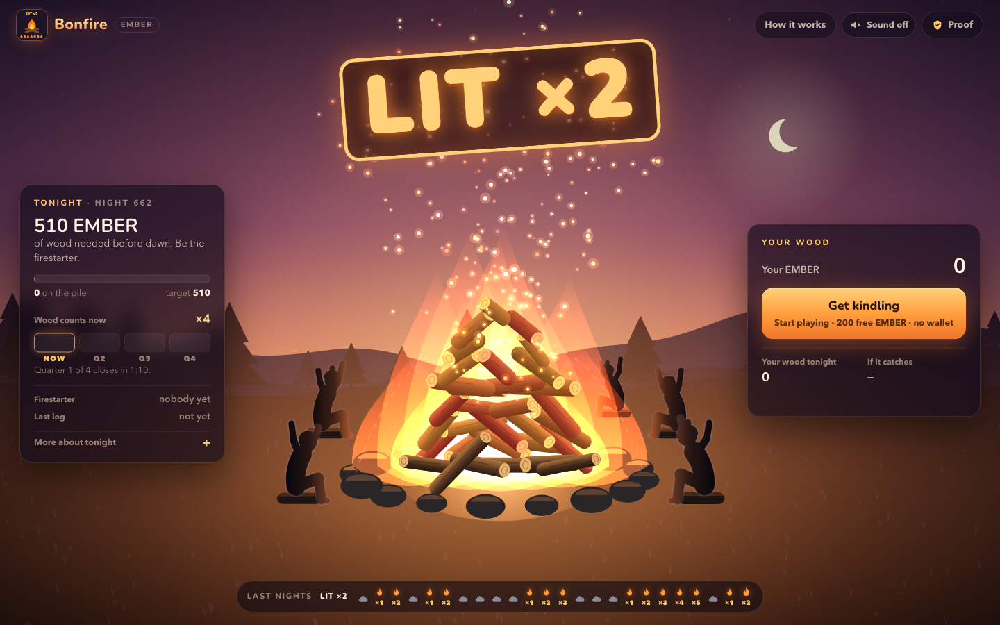
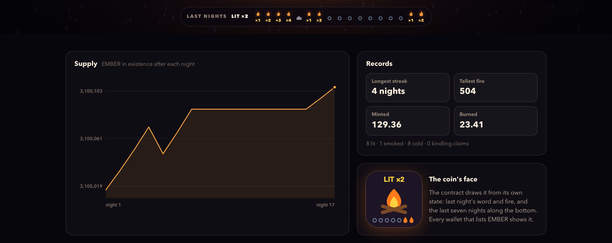
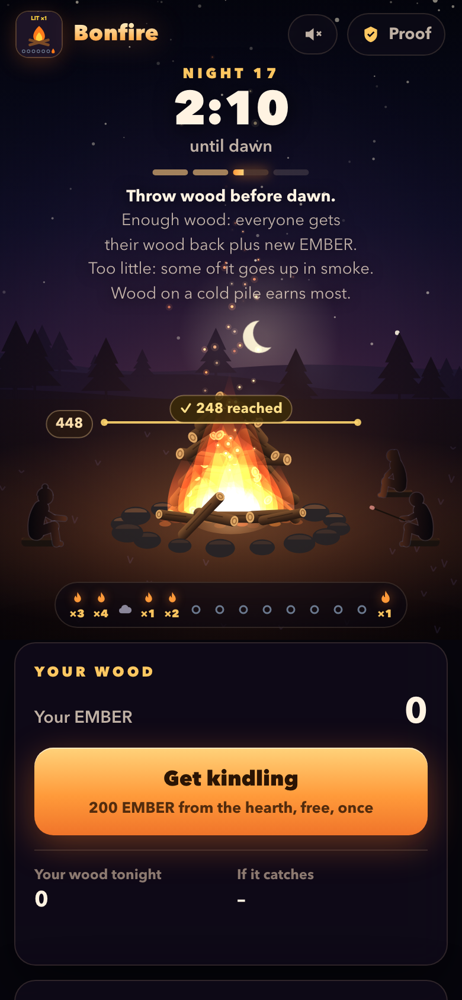

<p align="center"></p>

# Bonfire: a memecoin you light together

[](https://github.com/replaycourt/bonfire/actions/workflows/ci.yml)

The track asks for a memecoin whose meme does something, with every rule fixed at launch. Bonfire gives the holders of EMBER one shared job a night:

1. **Throw EMBER on tonight's pile.** Reach the target by dawn and the fire is LIT: everyone gets their wood back plus new EMBER, and wood on the cold pile earns the most. Fall short and it SMOKES: 3 % of the pile and a slice of the treasury burn. A night nobody plays burns nothing.
2. **The target follows the community:** +7 % after a lit night, −10 % after a miss. Every dawn is a small cliff-hanger: does it catch, who lit it, who threw the last log? The streak is on the page and on the coin's own icon, which the contract draws.
3. **One NEP-141 contract with 0 access keys** since 16 seconds into night 1: nobody can change a rule, and every rule is readable in `config()`.

**Play, no wallet:** https://replaycourt.github.io/bonfire/web/ (testnet, EMBER has no value; tap *Get kindling*, throw, wait for dawn: a testnet night lasts five minutes, at launch a day) · **Video, 80 s:** https://x.com/replaycourt/status/2119022580682146056 (or the [mp4](https://replaycourt.github.io/bonfire/web/media/bonfire-demo.mp4)) · **Judging:** [JUDGE.md](JUDGE.md), a five-minute path, and `scripts/judge-checks.sh`, six read-only checks of the live contract in about 5 seconds.

| You can check | How |
|---|---|
| Nobody can change a rule | `scripts/judge-checks.sh` checks 1 (0 access keys) and 4 (`config()` = `sim/params.json` plus two documented changes) |
| The contract settles like the simulation | `contract/tests/golden.rs`, to the base unit; 121 contract tests run in CI |
| Every mint and burn | the page's *Ledger*; `history()` and the NEP-297 `ft_mint` / `ft_burn` events |
| Who plays | five labelled demo bots, and 5 other accounts that had claimed kindling by 2026-11-08 (`state().records.kindling_claims`) |
| What the rules do not stop | [Honest limits](#honest-limits): a holder that lights alone, showing up compounds, a kindling farm |

<table>
<tr>
<td width="38%"></td>
<td width="38%"></td>
<td width="24%"></td>
</tr>
<tr>
<td><sub><b>Dawn</b>: the night settles on chain and the banner says how it ended, who lit it and who closed the gap.</sub></td>
<td><sub><b>The story so far</b>: every night as a flame, a puff of smoke or a cold ring, supply night by night, records, and the coin's face.</sub></td>
<td><sub><b>On a phone</b>: the same page.</sub></td>
</tr>
</table>

<sub>Screenshots of the page against the live contract `bonfire-coin.testnet` while the demo bots played, taken with headless Chrome; the screenshot tabs sent no transaction.</sub>

## How to play

1. **Open the page.** On a first visit it shows last night as a film of about ten seconds (*Replay of last night · Night N*, with *Skip*): the pile rises against its target, then dawn, the stamp and the banner, and *Play tonight* leads into the live night. See tonight's fire, the countdown to dawn with the night's four quarters, and the *Tonight* card: how much wood the fire still needs, the pile against the target, what wood counts right now (×4 on an empty pile), the firestarter and the last log, with throwers, streak and hearth under *More about tonight*. The five demo bots appear by name (`demo-bot-early-a` and so on). On a first visit, three numbered steps follow the replay (*Get kindling*, *Throw before dawn*, *See it catch at dawn* with its countdown), and the same numbers mark the button, the chips and the clock until dawn or until you hide them.
2. **Tap *Get kindling*.** See 200 EMBER arrive from the hearth, the contract's treasury. Sound comes on with this first tap (the *Sound on* button turns it off, and the page remembers). There is no wallet prompt: your browser made an ed25519 key, and that key's implicit account holds your EMBER. The hearth pays 4 claims a night; when they are gone the page counts down to the next dawn.
3. **Pick a chip (for example 25, 50, 100 or *All in*).** Before you tap, the hint says what that wood counts now and about how much new EMBER it brings if the fire catches; late in a night that can no longer catch, it says so and when the next night starts. Tap, and see your log fly onto the pile, the meter climb, and *Your wood tonight* and *If it catches* fill in.
4. **Wait for dawn.** A line under your wood counts down to your dawn, in the tab title too while the tab is hidden, with a short chime at dawn if sound is on. See dawn on stage: a stamp (*LIT ×n* or *SMOKED*), the banner at the top (*The fire caught!* with your wood back plus your share, or *Up in smoke* with what burned, and the night's firestarter and last log) and, if you threw, *Share your card*: a picture of the scene and your night with the coin's face the contract drew, *N of us lit night X* and the address; the button stays in *Your wood* until your next throw.
5. **Tap *Collect*,** or simply throw again: the next throw collects first. Your balance already counted the credit, as `ft_balance_of` does; collecting writes it into your account. Anyone may collect for anyone, and other open pages often do it first: then the box goes and a toast says the credit was collected for you.
6. **Tap *Proof* at the top.** It shows the contract, its 0 access keys, the code hash checked against this repository, *Try to cheat it* (real transactions the contract refuses), and every transaction this tab sent. Scroll down the page for the last nights as flames, smoke puffs and cold rings, the supply night by night, the records, and the coin's face as the contract draws it.

## The mechanic

**One night, three endings.** At dawn anyone may call `settle()` (the page does it on its own):

| Ending | When | What happens |
|---|---|---|
| **LIT** | the pile reached the target | Every thrower is owed all its wood back. The contract mints 4 % of the target: 10 % of it goes to the hearth, the rest to the throwers by weight. The target grows 7 %, the streak grows. |
| **SMOKED** | some wood, but short of the target | 3 % of the pile burns, the rest goes back pro rata. The hearth burns 0.25 % of itself, at most one night's mint. The target shrinks 10 %, the streak resets. |
| **COLD** | nobody threw | Nothing burns. The target shrinks 10 %, the streak resets. |

The target never exceeds 25 % of the free supply and never falls below its floor (100 EMBER on testnet).

**Kindlers earn most.** Wood is weighted by its place in the pile: the factor falls from ×4 on an empty pile to ×1 at the target, and wood above the target counts ×0.25. Whoever kindles the cold pile takes the smoke risk and earns the most; whoever warms their hands at a fire that is already safe earns a little.

**Quarters pool.** Each night is cut into four equal windows (75 seconds on testnet, six hours at the launch values). All wood that lands in the same quarter counts as landing together and shares that quarter's slice of the pile pro rata. Nobody owns the bottom of the pile by being first in a block, and splitting wood over many accounts earns nothing: ten accounts throwing X/10 in one quarter end the night with what one account throwing X gets, less at most one base unit each.

**The hearth: a treasury with rules.** It started with 3,000,000 EMBER on testnet. It gives 200 EMBER of kindling, once, to any account that never held EMBER, at most 4 claims a night. It is refilled by 10 % of every lit night's mint and burns a little on every smoky night. Nobody can withdraw from it; it has no owner.

**Pull payments.** Settling records only the night's totals, so it costs the same with five throwers or five thousand. Each thrower is credited when it next acts, or when anyone calls `collect(account)` for it.

**The coin's face.** `ft_metadata().icon` is an SVG the contract draws from its own state: at the top `LIT ×12` (letters that grow with the streak), `SMOKED` or `COLD`; in the middle last night's fire; along the bottom the last seven nights. A wallet or explorer that displays `ft_metadata().icon` shows the fire; many cache metadata, so they may show an older night.

The full rules are in [DESIGN.md](DESIGN.md), the API and its limits in [contract/README.md](contract/README.md).

## Fits the track

The `memecoins` prompt: *"Build memecoins where the meme does something: supply that reacts to the community, treasuries with rules, onchain rituals and challenges. Judged on the mechanic, not the chart."*

| The track asks for | In Bonfire | Where to check |
|---|---|---|
| Supply that reacts to the community | Lit nights mint 4 % of the target; smoky nights burn 3 % of the pile and part of the hearth; the target follows what the community throws (+7 % lit, −10 % smoked or cold). | `settle_night`, `next_target` in `contract/src/ritual.rs`; `contract/tests/ritual.rs`; live: `history()` |
| Treasuries with rules | The hearth: kindling for newcomers, refilled from every mint, burned on smoky nights, no withdrawal. | `do_claim_kindling`, `settle_night` in `contract/src/ritual.rs`; `contract/tests/kindling.rs`; live: `state().hearth` |
| Onchain rituals and challenges | One fire a night with a target to reach, a streak, records, and a named firestarter and last log. At launch a night is one day (`night_ms` 86,400,000, a daily ritual); this testnet demo runs five-minute nights so a visitor sees a whole night, dawn included, without a wallet. | live: `state()`, `records()`, `night(n)` |
| An NEP-141 token with the mechanic in the contract | EMBER is NEP-141 (with NEP-145 storage and NEP-148 metadata); throws, settling and payouts are contract code. | `contract/src/token.rs`, `contract/src/ritual.rs`; `contract/tests/token.rs` |
| All parameters fixed at launch and readable, no admin key | Every rule is an init argument shown by `config()`; no method changes them; the contract account has no access keys. | `scripts/judge-checks.sh` checks 1, 2 and 4; `contract/tests/surface.rs`; `contract/build.sh` export check |
| Sybil resistance good enough for a demo, limits written plainly | Pooled quarters, rewards pro rata to wood, kindling capped per night, sponsored accounts capped. | `contract/tests/sybil.rs`, `contract/tests/kindling.rs`; [Honest limits](#honest-limits) |
| A page with the streak, progress and a log of mints and burns | Streak on the *Tonight* card and the coin's face; the pile meter against the target and the quarter bar; the strip of the last 24 nights, minted and burned bars night by night, total minted and burned, and a dawn banner with the night's mint or burn. Per-night amounts: `history()` and the `ft_mint` / `ft_burn` events. | `web/`; `web/test/` |
| A 60-day simulation first | 60-night runs of nine scenarios and a parameter sweep picked the launch values; a golden test settles two scenarios in the contract exactly as the model does. Four scenarios also run for 365 nights, to show what compounds. | [docs/SIMULATION.md](docs/SIMULATION.md); `sim/bonfire_sim.py`; `contract/tests/golden.rs` |

**Where Bonfire departs from the prompt's example.** The target counts EMBER thrown, not accounts: accounts are free on NEAR, so a head count is met by one script with many keys, while counted wood makes splitting useless. The price is that one large holder can be the whole "community" (Honest limits). The mint is shared by weight, not equally per head, so early wood is paid for its smoke risk. A miss burns 3 % of the pile and a capped slice of the hearth, but a night nobody plays burns nothing: burning the hearth on empty nights outweighed the mint in a small community ([docs/SIMULATION.md](docs/SIMULATION.md), finding 8), and the price is that only the holders who showed up pay for a miss. The longest streak is the record under *Records*; the coin's icon shows the current one. Details: [DESIGN.md](DESIGN.md#where-bonfire-departs-from-the-prompt-and-why).

## Why NEAR

- **A contract nobody can change.** Sixteen seconds into night 1 (2026-11-06 09:50:43 UTC), the last access key of `bonfire-coin.testnet` was deleted (tx `8aK7rAMFFu6VkA1VbsVRvFjWRS6BP6gT9fWDBAxFT9KF`, [docs/testnet-launch.md](docs/testnet-launch.md)). Without a key nobody can redeploy it, so the code hash on chain today is the one from launch, and `contract/build.sh --check` rebuilds that hash from this repository. There is no owner, admin or upgrade method; `contract/build.sh` fails if the wasm exports anything beyond the ritual, NEP-141/145/148 and the views.
- **Play without a wallet.** Your browser signs each move with a key it made, and public function-call keys that may only call `act`, `settle` and `collect` pay the gas; how it works, and why not meta-transactions: [contract/README.md](contract/README.md#act-playing-from-a-browser-key).
- **NEP-141 with a dynamic icon.** EMBER is an ordinary fungible token: `ft_balance_of` and `ft_transfer` work as usual, and the balance already counts what a settled night owes. `ft_metadata().icon` changes with every settled night.
- **NEP-297 events.** The standard `ft_mint`, `ft_burn` and `ft_transfer` lines, as near-contract-standards writes them, plus `bonfire` events `throw`, `lit`, `smoked`, `cold` and `kindling`. Replaying the events gives every balance (`contract/tests/invariant.rs`).
- **Cheap.** On testnet a throw burns about 3 Tgas, a settle about 2.8 and a collect about 2.4 ([docs/testnet-stage.md](docs/testnet-stage.md)).

## Check it without an account

Plain curl against the public testnet RPC; python3 only decodes the view result, which the RPC returns as bytes. Run from the repository root.

```sh
# The contract has no access keys. Expect: "keys":[]
curl -s https://test.rpc.fastnear.com -H 'Content-Type: application/json' -d '{"jsonrpc":"2.0","id":1,"method":"query","params":{"request_type":"view_access_key_list","finality":"final","account_id":"bonfire-coin.testnet"}}'; echo

# No EMBER appears or vanishes. Expect: "balanced":true and "ledger":true
curl -s https://test.rpc.fastnear.com -H 'Content-Type: application/json' -d '{"jsonrpc":"2.0","id":1,"method":"query","params":{"request_type":"call_function","finality":"final","account_id":"bonfire-coin.testnet","method_name":"audit","args_base64":"e30="}}' | python3 -c 'import json,sys; print(bytes(json.load(sys.stdin)["result"]["result"]).decode())'

# The deployed code is the wasm whose sha256 this repository records (contract/WASM_SHA256); that
# this is the build of the source is shown by the rebuild under Build below. Expect: two equal lines
curl -s https://test.rpc.fastnear.com -H 'Content-Type: application/json' -d '{"jsonrpc":"2.0","id":1,"method":"query","params":{"request_type":"view_account","finality":"final","account_id":"bonfire-coin.testnet"}}' | python3 -c 'import json,sys,functools; s=json.load(sys.stdin)["result"]["code_hash"]; a="123456789ABCDEFGHJKLMNPQRSTUVWXYZabcdefghijkmnopqrstuvwxyz"; print(functools.reduce(lambda n,c: n*58+a.index(c), s, 0).to_bytes(32,"big").hex())'; cat contract/WASM_SHA256

# Every launch parameter, fixed at init. Expect: night_ms 300000, kindling_per_night 4, the five founders
curl -s https://test.rpc.fastnear.com -H 'Content-Type: application/json' -d '{"jsonrpc":"2.0","id":1,"method":"query","params":{"request_type":"call_function","finality":"final","account_id":"bonfire-coin.testnet","method_name":"config","args_base64":"e30="}}' | python3 -c 'import json,sys; print(json.dumps(json.loads(bytes(json.load(sys.stdin)["result"]["result"])), indent=1))'
```

## Simulation

Before the contract was final, [docs/SIMULATION.md](docs/SIMULATION.md) ran nine scenarios for 60 nights each (8 seeds, medians), swept the main knobs, and picked the launch values in `sim/params.json`. The launch values pass all 13 of its criteria. Key numbers with the launch values:

| | |
|---|---|
| Healthy community | lit on 80 % of nights, longest streak 27, supply 1.112× genesis at night 60 |
| Early wood against a sniper's completing throws, per EMBER | 2.0× in the healthy community, 3.95× in the sniper-heavy one |
| A holder with 12 % of supply that lights alone at the opening second | takes 67 % of the throwers' mint (93 % without pooled quarters) |
| The same holder over 365 nights | holds 65 % of supply, and has lost no wood to smoke; supply 17.2× genesis |
| Everyone throws everything (stress case) | supply 1.318× genesis in 60 nights (1.65× without the target cap), 17.9× in 365 nights: the cap limits one night's mint to 1 % of the free supply, not the level |
| Healthy community over 365 nights | supply 2.3× genesis; a holder who never throws keeps 43 % of its share |
| One balance split over 64 accounts | ends within about 2,000 yoctoEMBER (10⁻¹⁹) of the same balance in one account |
| Long-run lit rate, set by +7 % / −10 % | 61 % |


`python3 sim/bonfire_sim.py scenarios` (standard library only, about 80 seconds) reruns the scenarios and rewrites the tables and charts; on a copy of this repository it reproduced `docs/SIMULATION.md` and the three charts byte for byte. `python3 sim/bonfire_sim.py` adds the parameter sweep (about 20 minutes, per the document). `python3 sim/bonfire_sim.py longrun` writes the 365-night table (about 6 minutes on four cores). `contract/tests/golden.rs` checks that the contract settles two scenarios exactly like the model, to the base unit.

## What is real and what is not

- **Testnet only.** The contract is `bonfire-coin.testnet`. Nothing runs on mainnet.
- **EMBER has no value.** It is a testnet token with no market. Testnet NEAR only pays gas and storage.
- **Five demo bots keep the fire alive during judging.** `demo-bot-early-a`, `demo-bot-early-b`, `demo-bot-steady`, `demo-bot-late` and `demo-bot-idle` are run by a script, not by people, and the page labels them by those names. They follow fixed, published strategies ([scripts/bots.mjs](scripts/bots.mjs), `testnet.demo_bots` in `sim/params.json`). They never look at who threw; two of them (`demo-bot-steady`, `demo-bot-late`) look at the pile and the streak, as any player can, so a player's wood can change what they do. They run in GitHub Actions ([.github/workflows/fire.yml](.github/workflows/fire.yml)): every six hours, for just under six hours, and the workflow reads their keys only from a repository secret. They play by the same rules as everyone: their own keys, signed `act` calls through the same public gas keys, the same contract. Their one difference: they are the founders, so they got 100,000 of the 3,100,000 genesis EMBER instead of kindling. A watchdog workflow ([.github/workflows/watch.yml](.github/workflows/watch.yml)) checks the fire every hour (the read-only judge checks, the gas pool, that nights keep settling, the sponsored accounts and that the bots are running) and alerts the maintainer when something breaks.
- **Players so far: mostly the bots.** Read from the contract on 2026-11-08 at 18:16 UTC, night 678 (`state()`, `history()`, `ft_balance_of`; `audit()` balanced): five accounts besides the bots had claimed kindling (`state().records.kindling_claims`), and the bots held 104,243 of the 105,362 EMBER outside the hearth. The live record is therefore the bots running the simulation's behaviour models against the real contract: from night 106 to night 677, 357 nights lit, 214 smoked and 1 cold (63 % lit; the model's long-run rate is 61 %). That checks the model and the contract, not how people play. 79 of the 80 cold nights are nights 8-15 and 35-105, on launch day; the other is night 555.
- **97 % of the testnet supply is the hearth.** The launch made it 3,000,000 EMBER so that a script winning every kindling claim cannot empty it before 2026-11-19; at the launch values it is 40 % of supply. So the supply chart moves by hundredths of a percent. EMBER outside the hearth was 100,000 at genesis and 105,362 at night 678 (2026-11-08), +5.4 %, of which 1,000 came as kindling.
- **The gas keys are public, on purpose.** They are in [web/js/config.js](web/js/config.js). Anyone can spend their allowance, which pauses free play until the pool is refilled; they cannot touch anyone's EMBER. A NEAR account can still play with its own gas ([JUDGE.md](JUDGE.md#play-without-our-relay)).
- **The fire moves when someone calls.** The night clock runs on block time, but a night is settled by the next call (the page, the bots, or anyone). Nights nobody played settle cold, up to 30 per call.
- **The evidence comes from scripts.** The testnet runs so far were driven by scripts and headless browsers ([docs/testnet-stage.md](docs/testnet-stage.md), [docs/testnet-page-run.md](docs/testnet-page-run.md)), and the simulation models people with simple rules.

## Honest limits

- **A whale that lights alone is contained, not removed.** A holder whose balance covers the target can throw it all in the first second, and the fire can no longer smoke. Pooled quarters make everyone who throws in that first quarter share the bottom of the pile with it. In the simulation, a holder with 12 % of supply still takes about 67 % of the mint, without risk; its share depends on how much the community throws in the first quarter (`contract/tests/sybil.rs`: two thirds with the community in the same quarter, 95 % with the community a quarter later).
- **Showing up compounds.** A lit night pays its throwers new EMBER by weight, so a holder that throws safely every night gains share from everyone who throws less, and its larger balance earns more the next night. Over 365 nights at the launch values ([docs/SIMULATION.md](docs/SIMULATION.md#a-year-with-the-launch-values-what-compounds), 8 seeds): the holder with 12 % of supply that lights alone holds 23 % after 60 nights and 65 % after 365, losing no wood to smoke; with everyone throwing everything, every night is lit and supply grows 17.9×; the healthy community grows 2.3×, and a holder who never throws keeps 43 % of its share. The target cap limits one night's mint to 1 % of the free supply; it bounds neither the level nor anyone's share, and a holder with at least 25 % of the free supply can light every night alone. On testnet `demo-bot-early-a` holds about 40 % of the EMBER outside the hearth; its script throws about 200 a night. The open problem and candidate fixes for a mainnet launch: [DESIGN.md](DESIGN.md#before-a-mainnet-launch).
- **An exact-gap sniper earns within about 1.3× of early wood.** Inside a quarter every unit gets the quarter's average factor, so wood that exactly closes the gap in the last quarter is not the top of the pile alone. At `late_lit` 0.25 the model's sniper also warms a safe fire, and its wood as a whole earns 2-4× less than early wood (docs/SIMULATION.md, finding 3).
- **A kindling farm drains the hearth at a fixed rate.** Implicit accounts cost nothing, so "once per account" stops nobody. A script that wins every claim takes at most 200 EMBER × 4 claims × 12 nights = 9,600 EMBER an hour, so emptying the 3,000,000 EMBER hearth takes at least 312.5 hours (13 days), refills not counted. While it wins every claim, no newcomer gets kindling. At the launch values the rate is 2,500 EMBER a night.
- **4,505 sponsored seats.** The contract pays storage for the five bots and 4,500 kindling claimers. A farm that wins every claim fills them in 1,125 nights, about 94 hours. After that a newcomer needs someone with a NEAR wallet to call `storage_deposit` for its account before it can claim kindling.
- **`estimate()` uses the stored target while nights are due.** It applies the target floor but not the shrink of the unsettled nights, so during a backlog it shows a different factor than the throw will get. It is a view only: no amount is affected, and the page does not ask for it while a night is due.
- **AI-generated code.** An AI coding agent (Claude) wrote the code and documentation from a human's brief during the hackathon window. The evidence that it works: 121 contract tests, a golden test that settles two scenarios exactly as the simulation does, `audit()` balanced on every night on chain, and the staging and launch runs on testnet. No human reviewed it line by line, and the contract has not been audited.

## Run it yourself

The page is static files with no build step and no dependencies: `web/index.html`, CSS and ES modules. Serve the repository root and open `/web/`:

```sh
python3 -m http.server 8765 --bind 127.0.0.1
# live testnet contract:      http://127.0.0.1:8765/web/
# made-up data, no chain:     http://127.0.0.1:8765/web/?mock=1
```

It needs Ed25519 in WebCrypto: Chrome 137+, Safari 17+ or Firefox 130+. The page has a strict Content-Security-Policy (`default-src 'self'`; connections only to the two testnet RPC hosts) and loads nothing from a CDN.

**Tests.**

```sh
node --test 'web/test/*.test.mjs'       # 106 tests: page logic, signing, RPC fallback, config; about 6 s
node --test 'scripts/test/*.test.mjs'   # 7 tests: relay nonce retries, bot key secret; offline, about 1 s
cd contract && cargo test               # 121 tests; cold build about 8.5 minutes, then about 1 s
scripts/judge-checks.sh                 # 6 read-only checks of the live contract; about 5 s
```

CI runs the three test suites on every push and rebuilds the wasm on Linux, an Intel Mac and an arm64 Mac: since 2026-11-07 all three are byte-identical to the code on chain, and a difference fails the run. Until 2026-11-07 they differed from the deployed code built on the author's Mac only because the CI job set `CARGO_NEAR_VERSION`, which cargo-near writes into the ABI embedded in the wasm; `build.sh` now unsets it (section by section in the job summary; see contract/README.md, "Rebuilding the deployed wasm"). Node 22 or newer, no install. `cargo test` uses the toolchain pinned in `contract/rust-toolchain.toml` (Rust 1.95.0); the tests run in the SDK's mock VM, with no sandbox and no network.

**Build.** `cd contract && ./build.sh --check` rebuilds the wasm with cargo-near 0.22 and compares its sha256 with `contract/WASM_SHA256`, the code hash on chain. It also fails if the wasm carries machine paths or exports an unexpected method. `python3 contract/compare-wasm.py contract/target/near/bonfire.wasm --account bonfire-coin.testnet` compares the result with the code on chain, section by section. Cold rebuilds on a 4-core Intel Mac (macOS 15, x86_64) took about 20 minutes and were byte-identical to the chain; CI repeats the rebuild on Linux and on Intel and arm64 Macs. What is reproduced where, and why: [contract/README.md](contract/README.md#rebuilding-the-deployed-wasm).

**Your own deployment.** `scripts/setup-gas-pool.mjs` adds relay keys to a gas account, and `scripts/deploy.mjs <account> [--lock]` deploys with the account's key from the NEAR CLI's legacy keychain, initialises with the testnet values, verifies, and with `--lock` deletes every access key. Both are described in [docs/testnet-stage.md](docs/testnet-stage.md).

## Hackathon note

Built at NEAR HACKATHON for the `memecoins` track. The relay and signing code (`web/js/near.js`, `web/js/chain.js`, `scripts/near-lite.mjs`) is adapted from the author's earlier project Lantern Row, https://github.com/replaycourt/lantern-row.

The same author also entered the independent project Hat Tip, https://github.com/replaycourt/hat-tip (peer thanks paid out through a Sputnik DAO, `social` track), in this hackathon.

## Credits

Art drawn in code (Canvas 2D and SVG), sounds synthesised in WebAudio. Libraries: near-sdk and near-contract-standards in the contract; ed25519-dalek and near-parameters in its tests only. The page and the scripts use nothing beyond the browser and Node's standard library.

## License

MIT, see [LICENSE](LICENSE).
